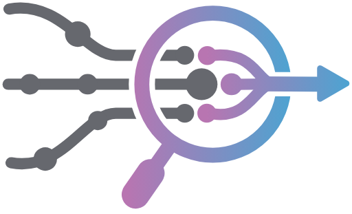

---
hide:
  - toc
  - path
  - title
---

<style>
  /* Full-width home page; the header keeps its own max-width */
  .md-main__inner,
  .md-content,
  .md-main .md-grid {
    max-width: 100% !important;
    margin: 0 !important;
  }

  .md-content__inner {
    max-width: 100% !important;
    padding: 0 !important;
    margin: 0 !important;
  }

  @media (min-width: 76.25em) {
    .md-sidebar {
      display: none !important;
    }
  }

  .md-content h1,
  .md-content__inner > h1:first-child,
  .md-typeset h1 {
    display: none !important;
  }

  /* Hero */
  .nn-hero {
    position: relative;
    min-height: 100vh;
    display: flex;
    align-items: center;
    justify-content: center;
    overflow: hidden;
  }

  /* A fixed grid behind the hero: fine lines with a dot at each crossing, drifting slowly,
     fading out toward the edges. */
  .fixed-background {
    position: fixed;
    top: 0;
    left: 0;
    width: 100%;
    height: 100vh;
    z-index: 0;
    --grid-line: rgba(75, 106, 114, 0.14);
    --grid-dot: rgba(75, 106, 114, 0.38);
    --grid-step: 36px;
    background-color: var(--md-default-bg-color);
    background-image:
      radial-gradient(circle, var(--grid-dot) 1px, transparent 1.5px),
      linear-gradient(to right, var(--grid-line) 1px, transparent 1px),
      linear-gradient(to bottom, var(--grid-line) 1px, transparent 1px);
    background-size: var(--grid-step) var(--grid-step);
    background-position: 0 0;
    -webkit-mask-image: radial-gradient(ellipse 70% 70% at 50% 45%, #000 30%, transparent 100%);
    mask-image: radial-gradient(ellipse 70% 70% at 50% 45%, #000 30%, transparent 100%);
    animation: nn-grid-drift 90s linear infinite;
  }

  [data-md-color-scheme="slate"] .fixed-background {
    --grid-line: rgba(143, 176, 180, 0.12);
    --grid-dot: rgba(143, 176, 180, 0.34);
  }

  @keyframes nn-grid-drift {
    from { background-position: 0 0; }
    to { background-position: var(--grid-step) var(--grid-step); }
  }

  @media (prefers-reduced-motion: reduce) {
    .fixed-background {
      animation: none;
    }
  }

  .nn-hero-content {
    position: relative;
    z-index: 1;
    display: flex;
    flex-direction: row;
    align-items: center;
    gap: 4rem;
    max-width: 1400px;
    padding: 2rem;
    background: transparent;
    border-radius: 0.5rem;
  }

  .nn-hero-texts {
    position: relative;
    z-index: 1;
    display: flex;
    flex-direction: column;
    align-items: center;
  }

  .nn-hero-text {
    display: flex;
    flex-direction: column;
    gap: 1rem;
  }

  .nn-hero-desc {
    font-size: 1.15rem;
    line-height: 1.5;
    color: var(--md-default-fg-color--light);
    margin: 0;
  }

  .nn-hero-links {
    display: flex;
    flex-direction: row;
    gap: 0.5rem;
    flex-wrap: wrap;
    position: relative;
    z-index: 2;
  }

  .nn-hero-links a {
    padding: 0.5rem 1.2rem;
    border-radius: 20px;
    font-size: 0.78rem;
    font-weight: 600;
    text-decoration: none;
    transition: opacity 0.2s;
  }

  .nn-hero-links a:hover {
    opacity: 0.85;
  }

  .nn-hero-links .nn-btn-primary {
    background: linear-gradient(135deg, #4b6a72, #5f7d66);
    color: #fff;
  }

  .nn-hero-links .nn-btn-secondary {
    background: var(--md-default-bg-color);
    border: 1px solid var(--md-default-fg-color--lighter);
    color: var(--md-default-fg-color);
  }

  .nn-hero-logo {
    flex-shrink: 0;
  }

  .nn-hero-title h1 {
    display: block !important;
    font-size: 2.5rem;
    font-weight: 700;
    margin-bottom: 20pt;
    color: var(--md-default-fg-color);
  }

  .nn-hero-logo img {
    width: 550px;
    height: auto;
  }

  /* Content section below the hero */
  .nn-home-content {
    position: relative;
    z-index: 1;
    max-width: 1600px;
    margin: 0 auto;
    padding: 3rem 2rem 4rem;
    background: transparent;
  }

  .nn-home-content h2 {
    font-size: 1.5rem;
    font-weight: 700;
    margin-top: 2rem;
    margin-bottom: 0.75rem;
  }

  .nn-home-content p,
  .nn-home-content li {
    font-size: 1rem;
    line-height: 1.6;
    color: var(--md-default-fg-color--light);
  }

  .nn-home-content ul {
    padding-left: 1.25rem;
  }

  .nn-home-content code {
    font-size: 0.85rem;
  }

  /* Responsive - intermediate */
  @media (max-width: 1100px) {
    .nn-hero-logo img {
      width: 400px;
    }
    .nn-hero-content {
      gap: 2rem;
    }
  }

  /* Responsive - mobile */
  @media (max-width: 768px) {
    .nn-hero-content {
      flex-direction: column-reverse;
      gap: 2rem;
      text-align: center;
    }
    .nn-hero-links {
      justify-content: center;
    }
    .nn-hero-logo img {
      width: 350px;
    }
    .nn-hero {
      min-height: 70vh;
    }
  }
</style>

<div class="fixed-background"></div>

<div class="nn-hero">
  <div class="nn-hero-content">
    <div class="nn-hero-texts">
      <div class="nn-hero-title">
        <h1>Standardized Access for Interpretability</h1>
      </div>
      <div class="nn-hero-text">
        <p class="nn-hero-desc">
          <strong>nnterp</strong> gives every transformer family the same module names and the same
          standard values, on top of <a href="https://nnsight.net">nnsight</a>. An experiment written
          once runs on GPT-2, Llama, Qwen, Gemma, Mamba and the other supported families.
        </p>
        <div class="nn-hero-links">
          <a href="getting-started/" class="nn-btn-primary">Get Started</a>
          <a href="guide/" class="nn-btn-secondary">Guide</a>
          <a href="tutorials/" class="nn-btn-secondary">Tutorials</a>
          <a href="documentation/" class="nn-btn-secondary">Documentation</a>
          <a href="about/" class="nn-btn-secondary">About</a>
        </div>
      </div>
    </div>
    <div class="nn-hero-logo">
      
    </div>
  </div>
</div>

<div id="content" class="nn-home-content md-typeset" markdown>

## What is NNterp?

`StandardizedTransformer` is an nnsight `TransformersModel`, so `trace`, `generate`, `.save()`,
`tracer.iter` and `remote=True` work as they do in nnsight. What changes is the names that you write
and the values that you read.

Every family answers to Llama's names: `model.embed_tokens`,
`model.layers[i]`, `model.layers[i].self_attn`, `model.layers[i].mlp`, `model.norm`,
`model.lm_head`. Because they are aliases, GPT-2's `model.transformer.h[5]` and `model.layers[5]` are
the same envoy and the native names keep working.

A name says which module; a value says which tensor, and it means the same
thing on every family. `layer_output` is the residual stream leaving a block whether the block
returns a tensor or a tuple. `attention_output` and `mlp_output` are what each sublayer adds to
the stream, so on every family

```
layers[i].input + attention_output + mlp_output == layers[i].layer_output
```

Not every checkpoint has every value. Before you trace, `model.support()` says what this
one has and, for anything missing, why.

```bash
pip install nnterp
```

```python
from nnterp import StandardizedTransformer

model = StandardizedTransformer("openai-community/gpt2")   # or a Llama, a Pythia, ...

with model.trace("The Eiffel Tower is in"):
    attn = model.layers[5].self_attn.attention_output.save()   # what attention adds
    resid = model.layers[5].layer_output.save()                # the residual stream leaving block 5
    logits = model.logits.save()

print(attn.shape, resid.shape, logits.shape)
# torch.Size([1, 7, 768]) torch.Size([1, 7, 768]) torch.Size([1, 7, 50257])
```

Add `remote=True` to run the same block on a model hosted by [NDIF](https://ndif.us/).

</div>
